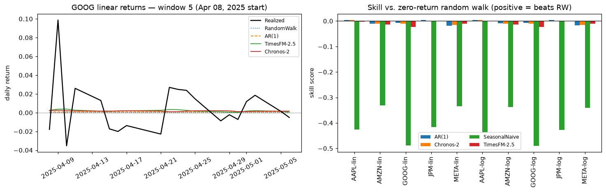

# Time-Series Foundation Models for Return Forecasting — Findings and Product Implications

**Date:** July 2026 · **Artifacts:** [`tsfm_return_benchmark.ipynb`](./tsfm_return_benchmark.ipynb) (executed), [`benchmark_lib.py`](./benchmark_lib.py), [`data/prices_adjclose.csv`](./data/prices_adjclose.csv)

---

## 1. The question this answers

Are there AI models trained *mathematically* on prediction itself, grounded in real public
data and real-world outcomes — and do they matter for this product? Two families exist as
of mid-2026:

1. **Time-series foundation models (TSFMs)** — networks pretrained on ~100B+ real-world
   data points to forecast any numeric series zero-shot, with calibrated quantiles:
   Google **TimesFM-2.5**, Amazon **Chronos-2**, Salesforce **Moirai-2.0**, Nixtla
   **TimeGPT**, plus domain models (Aurora for weather, MacroCast for macro data).
2. **LLM-based event forecasters** — agents that pull live news/market data and output
   probabilities for real-world events (Metaculus bots, FutureSearch, Mantic). Useful,
   but still behind top human forecasters and systematically overconfident.

This document covers a hands-on evaluation of family 1 on the hardest public target —
daily equity returns — and what the result means for the diligence platform.

## 2. The paper being replicated

> Noguer i Alonso, M. & Pereira Franklin, R. (2026). *Pretrained Time-Series Foundation
> Models for Financial Return Forecasting.* arXiv:2606.27100 [q-fin.MF].

The paper benchmarks six pretrained TSFMs (zero-shot) against five train-from-scratch
neural baselines on daily returns of AAPL, AMZN, GOOG, JPM, META. Its three findings:

- **TSFMs dominate the ranking** — 8 of 10 task wins with no training on the target
  assets (Moirai-2.0 and TimesFM-2.5 lead; iTransformer takes both META tasks).
- **Almost nothing beats "predict zero."** Gains over the zero-return random walk are
  small and sparse; only 2 pairs are DM-significant at 5% (Chronos/AMZN, Moirai/GOOG,
  both p = 0.0421).
- **The ceiling is the data, not the model.** Past daily returns carry ≈ 0.005 nats
  (a small fraction of one bit) of information about future returns, capping
  out-of-sample R² below ~1%. Every architecture competes for the same crumbs, and the
  Kelly/directed-information bound means even a "significant" edge is economically tiny
  before costs.

Their verdict: TSFMs are **useful practical priors** in low-data settings — not alpha
engines.

## 3. What we ran

A faithful replication of the paper's protocol, executed end-to-end in this repo:

| Item | Setting |
| --- | --- |
| Assets | AAPL, AMZN, GOOG, JPM, META (Yahoo Finance adjusted closes, 2014-09-15 → 2026-02-13) |
| Targets | Linear and log daily returns (10 tasks) |
| Models | **TimesFM-2.5** (200M) and **Chronos-2** (120M), both zero-shot, median point forecast; AR(1); weekly seasonal naive; zero-return random walk |
| Protocol | Context L = 512, horizon H = 20 business days, 10 rolling-origin windows over Aug 2024 → Feb 2026 |
| Metrics | MAE; skill vs. random walk; rMAE vs. seasonal naive; one-sided Diebold–Mariano test (H1: model beats RW) with Harvey–Leybourne–Newbold correction, pooled over 200 forecast points per task |

Deviations from the paper, kept deliberate: the paper's exact rolling-origin calendar
anchors are unpublished, so origins are spaced evenly across the evaluation segment; we
run 2 of their 6 TSFMs (no TimeGPT API key; Moirai omitted) and skip their five
train-from-scratch baselines in favor of AR(1), which their appendix shows is the
hardest cheap baseline. Expect matching magnitudes and conclusions, not digits.

Practical note: both models ran all 100 forecasts in ~17 s **on CPU** after a one-time
~1.3 GB weight download — no GPU, no training pipeline, no API keys.

## 4. Results

**Task-level winners (10 tasks).** AR(1) takes 5, Chronos-2 takes 3, TimesFM-2.5
takes 2. Average MAE ranks: **AR(1) 1.7, Chronos-2 1.9, TimesFM-2.5 2.4, seasonal
naive 4.0**.

| Return | Ticker | Winner | MAE | Skill vs. RW |
| --- | --- | --- | --- | --- |
| linear | AAPL | Chronos-2 | 0.012477 | +0.0039 |
| linear | AMZN | Chronos-2 | 0.015461 | −0.0101 |
| linear | GOOG | AR(1) | 0.013753 | −0.0078 |
| linear | JPM | AR(1) | 0.012136 | +0.0038 |
| linear | META | TimesFM-2.5 | 0.016953 | −0.0106 |
| log | AAPL | Chronos-2 | 0.012431 | +0.0040 |
| log | AMZN | AR(1) | 0.015442 | −0.0091 |
| log | GOOG | AR(1) | 0.013717 | −0.0073 |
| log | JPM | AR(1) | 0.012112 | +0.0039 |
| log | META | TimesFM-2.5 | 0.016840 | −0.0099 |

**Statistical significance: none.** 0 of 40 model–task Diebold–Mariano tests reject the
null of "no better than the random walk" at 5% (best p ≈ 0.103, AR(1) on AAPL log).
Every skill score sits within ±0.02 of zero. The paper found 2 of its pairs significant
at p = 0.0421; our independent run, with different window anchors and fewer models, found
zero — if anything a starker version of the same message.



**Three takeaways:**

1. **Pretraining works as a free inductive prior.** Chronos-2 matches a locally fit
   AR(1) on assets it has never seen, with zero training cost. On more predictable
   series this prior is a genuine head start.
2. **Daily equity returns are near-unpredictable, and no model fixes that.** This is a
   property of efficient markets, not of the models.
3. **Ranking wins ≠ economic edge.** With 10 windows per task, top-model differences sit
   at the statistical noise floor. Any forecasting claim needs the DM-style test, not a
   leaderboard position.

## 5. What this means for Connected Capital (the diligence platform)

**Our domain is the favorable one.** The platform forecasts multi-year real-estate
returns, not daily equities. The repo's own committed ZHVI series shows lag-1
autocorrelation ≈ **0.98** (`data/processed/zillow_national_zhvi/meta.json`) — housing
indices carry vastly more conditional information per observation than the
near-martingale series benchmarked here. The same zero-shot models that cannot beat a
random walk on AAPL are credible forecasters of a metro's home-value path over a 1–5
year hold.

**A cycle-aware upgrade path for the engine.** Today `src/model/mc_reference.py` fits an
*unconditional* μ/σ from history and simulates forward — the market prior is identical at
a cycle peak and a cycle trough, with the analyst's `mu_adj` as the only conditioning. A
TSFM quantile forecast of the market factor (ZHVI/FHFA for the deal's metro, over the
actual holding period) would supply a *conditional* base rate instead. It composes
cleanly with the glass-box design: the TSFM contributes only the market-path prior;
Geltner de-smoothing, bias haircuts, deal-specific spread, DDQ weights, and Kelly
discipline all stay where they are. Chronos-2 natively emits the nine quantiles the
Monte Carlo could consume as scenario paths, and it runs in seconds on CPU — compatible
with the local-first bake step (cache forecast quantiles next to `latest_fit.json` at
ingest).

**The harness is the acceptance test.** `benchmark_lib.py` now contains the standard
machinery — rolling-origin evaluation, skill vs. naive baselines, one-sided
HLN-corrected DM test — to make any forecasting claim auditable. Proposed gate: **no
conditional overlay touches `mu_adj` until it rejects the null against
random-walk-with-drift and seasonal naive on ZHVI/FHFA monthly returns, per metro.** If
an overlay earns its way in, the DM p-value itself becomes UI content alongside the
existing honest-limits banners.

**What not to build.** The negative result is protective: there is no case for adding
liquid-asset return prediction to the product, and this notebook is the two-minute
rebuttal to any "AI market forecaster" pitch for equities or REIT prices. It also
validates the product's positioning — the moat (client deal outcomes + analyst DDQ
judgment, public data as auditable base rates) sits exactly where the evidence says the
edge lives: in proprietary and idiosyncratic information, not public-market prediction.

## 6. Recommended next experiment

Point the same harness at the housing series already committed in `data/processed/`:
Chronos-2 vs. AR(1) vs. drifted random walk vs. seasonal naive on ZHVI monthly returns
for the top metros, rolling-origin with a 12–24 month horizon. That single run decides
whether a TSFM market prior belongs in the scoring engine. The infrastructure is in
place; only the data loader changes.

## 7. Reproducing

```bash
cd research/tsfm_benchmark
python3 -m venv .venv && source .venv/bin/activate
pip install torch --index-url https://download.pytorch.org/whl/cpu
pip install -r requirements.txt
jupyter nbconvert --to notebook --execute --inplace tsfm_return_benchmark.ipynb
```

Prices are cached in `data/prices_adjclose.csv`, so the run is deterministic and
offline after the one-time model-weight download.

## References

- Noguer i Alonso & Pereira Franklin (2026), arXiv:2606.27100 — the replicated paper.
- Rahimikia, Ni & Wang (2025), SSRN 5770562 — finance-native pretraining closes the gap
  that zero-shot/fine-tuned generic TSFMs leave open.
- TimesFM: [github.com/google-research/timesfm](https://github.com/google-research/timesfm) ·
  Chronos: [github.com/amazon-science/chronos-forecasting](https://github.com/amazon-science/chronos-forecasting)
